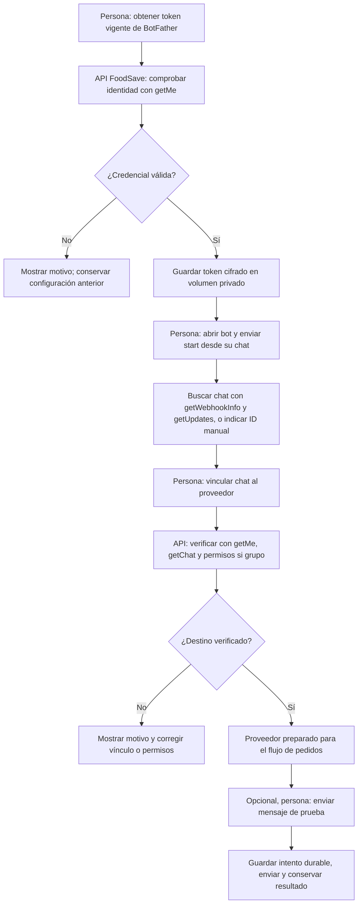

# Bot de Telegram: configuración y API usada por FoodSave

**Corte 20-10-2026.** Canal implementado para pruebas de mensajes y envío de pedidos. Bot indicado por Axel: **[@foodsave_proveedor_bot](https://t.me/foodsave_proveedor_bot)**. Es su dirección pública; la aplicación valida la identidad real del bot al guardar/comprobar la credencial.

## Datos públicos y credencial privada

| Dato | Valor o ubicación |
|---|---|
| Usuario del bot | `@foodsave_proveedor_bot` |
| Abrir conversación | [t.me/foodsave_proveedor_bot](https://t.me/foodsave_proveedor_bot) |
| API oficial | [Telegram Bot API](https://core.telegram.org/bots/api) |
| Administrar el bot | [BotFather](https://t.me/BotFather) |
| Token HTTP | Credencial privada obtenida de BotFather; introducir en FoodSave, no en este documento |
| Destino de prueba | Chat propio vinculado a cada proveedor; su identificador se guarda en la base local |

El token permite controlar el bot. Para la credencial compartida en el chat, regenerarla en BotFather y configurar la nueva privadamente. Telegram documenta su [gestión de bots y tokens](https://core.telegram.org/bots/features#botfather). No pegar el token en Markdown, capturas, ejemplos, URLs públicas o commits.

FoodSave guarda el token cifrado en `telegram_secrets/bot.enc` (volumen Docker); API escribe y worker lee. El cifrado depende de `JWT_SECRET`, que debe tener al menos 32 caracteres y permanecer estable. Si cambia ese secreto, volver a guardar el token. `TELEGRAM_BOT_TOKEN` en el entorno privado es un fallback cuando no hay configuración guardada; la opción recomendada para este recorrido es la pantalla de Proveedores. Git no traslada ninguno de estos secretos a otra PC.

Si se regenera el token, actualizarlo en FoodSave y comprobar bot/destinos de nuevo. Los envíos ya reservados conservan la huella de la credencial anterior; el worker detecta el cambio antes de transmitir. Revisar su estado y la recuperación de Compras, sin reenviar a ciegas.

## Configurar en una instalación nueva

1. Entrar como Administrador → **Proveedores → Conexión de Telegram → Configurar Telegram**.
2. Introducir el token vigente de BotFather y guardar. FoodSave llama a `getMe`, valida el bot y solo guarda la nueva credencial si la comprobación resulta válida. Revisar el usuario devuelto; debe coincidir con el bot que se quiere usar.
3. Desde la cuenta propia que recibirá las pruebas, abrir [el bot](https://t.me/foodsave_proveedor_bot) y pulsar **Iniciar** o enviar `/start`.
4. Abrir la gestión de cada proveedor y la sección de chat. **Buscar mi chat** consulta los inicios recientes; seleccionar el chat propio y confirmar **Vincular chat**. También existe entrada manual del identificador numérico. `chat_id` no es el nombre de usuario del bot ni un número de teléfono.
5. Pulsar **Verificar chat vinculado**. La verificación valida acceso/permisos; no acredita que se haya entregado un mensaje.
6. Si se desea comprobar transmisión, pulsar deliberadamente **Enviar mensaje de prueba**. Es un mensaje real al chat configurado y no corresponde a un pedido. Revisar el mensaje en Telegram y el resultado conservado en FoodSave. Un resultado incierto requiere revisar el chat antes de otra prueba.
7. Para los grupos actuales, repetir vínculo/verificación en los dos proveedores asignados. Se puede usar el mismo chat propio para esta prueba. Seguir la [guía de reproducción](../../datos_carga/referencias/replicar_proveedores_otra_pc.md) para las ofertas; configurar el bot no crea ofertas ni corrige pedidos anteriores.

**Límites actuales:** el cliente admite chat privado o grupo/supergrupo propio de pruebas, con permiso de escritura; no canales. La búsqueda usa `getUpdates` puntualmente, no un servicio permanente que interprete respuestas. Si el bot tiene webhook, la búsqueda devuelve `BOT_CON_WEBHOOK`; usar un bot exclusivo o vincular el `chat_id` conocido manualmente. FoodSave no borra webhooks de otros consumidores.

## API externa de Telegram

Formato de petición del adaptador:

```http
POST https://api.telegram.org/bot<TOKEN_PRIVADO>/<METODO>
Content-Type: application/json
```

Este es un esquema con marcador, no una URL con credencial real. FoodSave envía JSON por HTTPS y valida la respuesta `ok`/`result`, sin registrar URLs con el token. Referencia del formato: [Making requests](https://core.telegram.org/bots/api#making-requests).

| Método oficial | Para qué lo llama FoodSave | ¿Envía un mensaje? |
|---|---|---|
| [getMe](https://core.telegram.org/bots/api#getme) | Comprobar token e identidad del bot | No |
| [getWebhookInfo](https://core.telegram.org/bots/api#getwebhookinfo) | Detectar un webhook antes de buscar chats | No |
| [getUpdates](https://core.telegram.org/bots/api#getupdates) | Buscar chats con `/start` reciente, límite 100, timeout 0, sin confirmar actualizaciones mediante offset | No |
| [getChat](https://core.telegram.org/bots/api#getchat) | Comprobar identidad y tipo del destino | No |
| [getChatMember](https://core.telegram.org/bots/api#getchatmember) | Revisar permisos del bot en grupos | No |
| [sendMessage](https://core.telegram.org/bots/api#sendmessage) | Transmitir una prueba explícita o un pedido autorizado | **Sí** |

Para enviar, el adaptador utiliza `chat_id`, `text` y `link_preview_options: {"is_disabled": true}`. La evidencia de éxito incluye `message_id`, `date` y el chat esperado. Un timeout o respuesta sin evidencia suficiente deja resultado incierto: no se reenvía automáticamente. Los pedidos siguen la outbox de Compras; la prueba desde Proveedores reserva su evidencia antes de transmitir en la propia solicitud HTTP.

## API interna de FoodSave

Rutas existentes, con prefijo **`/api/v1`** y autenticación de Administrador para configuración, vínculo, verificación y pruebas:

| Método y ruta | Acción |
|---|---|
| `GET /proveedores/telegram/configuracion` | Leer estado sin devolver token |
| `POST /proveedores/telegram/configuracion` | Comprobar y guardar `{"token":"<TOKEN_PRIVADO>"}` |
| `POST /proveedores/telegram/comprobar` | Comprobar credencial configurada contra Telegram |
| `POST /proveedores/telegram/chats-pruebas` | Buscar chats propios iniciados recientemente |
| `PUT /proveedores/{id}/chat?chat_id=<ID_PRIVADO>` | Vincular destino al proveedor |
| `POST /proveedores/{id}/verificar-destino` | Verificar acceso/permisos |
| `POST /proveedores/{id}/mensaje-prueba` | Enviar prueba explícita según esquema de la API |
| `GET /proveedores/{id}/mensajes-prueba` | Consultar evidencia e intentos de prueba |
| `DELETE /proveedores/telegram/configuracion` | Deshabilitar la credencial guardada |

Para cuerpos completos y validaciones usar el [contrato de pedidos/canal](contrato-pedidos.md) y el OpenAPI local (`http://localhost:8000/docs`, según puertos configurados). No ejecutar `sendMessage` fuera del recorrido de FoodSave para verificar una automatización: no generaría su evidencia de pedido.

## Flujo de conexión para diagramar



Este flujo es configuración asistida y prueba explícita, **no otro tipo de ejecución automática**. Después, el envío de pedidos sigue [F06: aprobación y Telegram](../automatizacion/flujos-implementados.md#f06-aprobación-y-envío-de-pedidos-por-telegram); confirmar llegada física sigue F08, no una respuesta automática del bot.

## Fuentes y verificación de este corte

Contrastado con [adaptador Telegram](../../backend/app/integrations/proveedores/telegram.py), [rutas de Proveedores](../../backend/app/modules/proveedores/rutas.py), [pruebas de mensaje](../../backend/app/modules/proveedores/pruebas_mensaje.py) y [outbox de Compras](../../backend/app/modules/compras/envios.py). La documentación oficial enlazada se consultó para el formato y métodos. **En este corte solo se documenta:** no se guardó el token recibido, no se comprobó contra la API, no se rotó la credencial ni se envió ningún mensaje.
