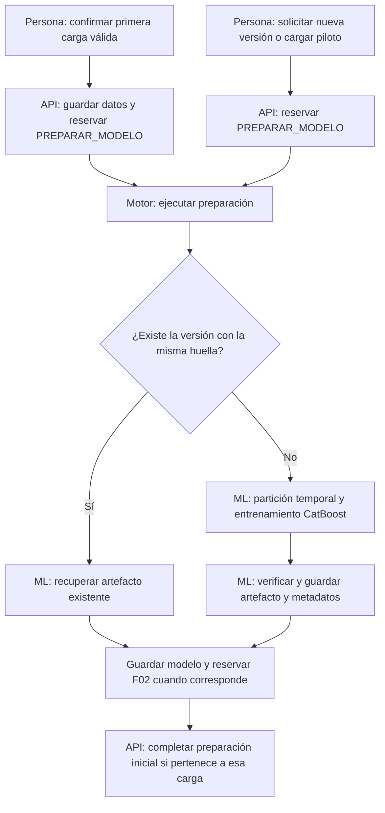
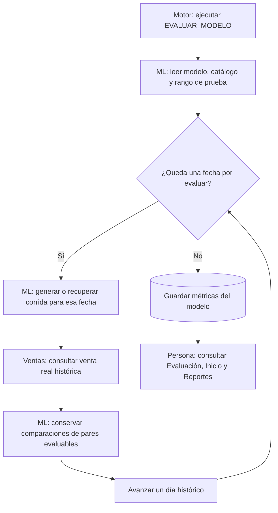
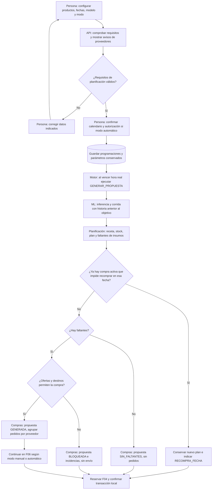
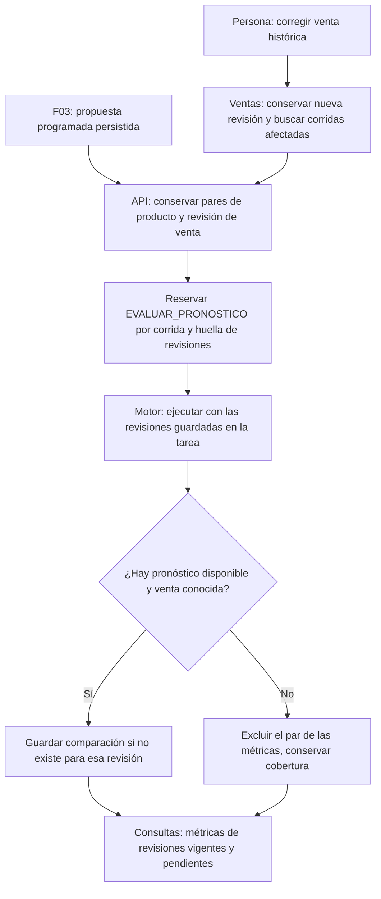
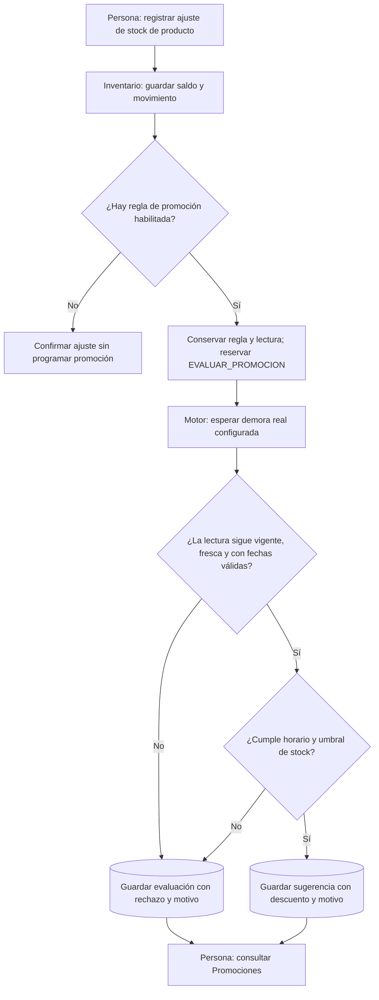
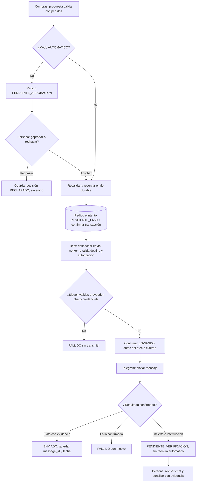
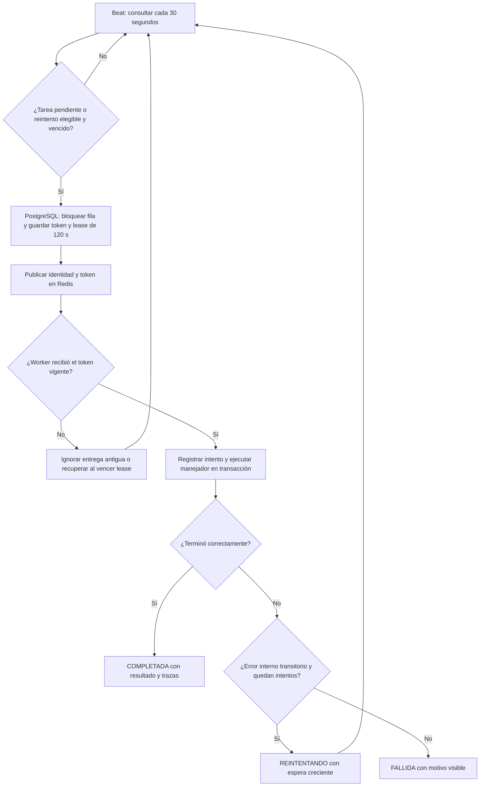
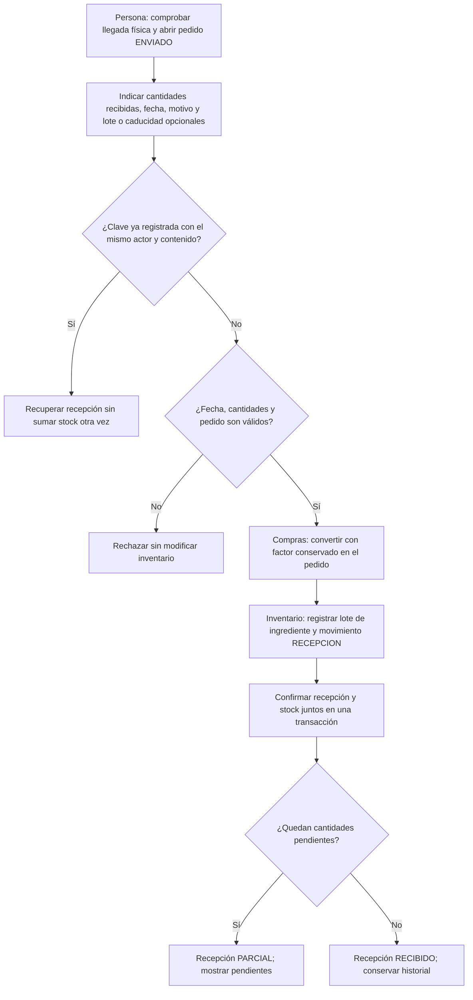

# Flujos implementados para diagramar

Corte: **20-10-2026**, código integrado en `cueva` hasta `b1b7713`. Este documento describe lo implementado; no ejecuta tareas. Los diagramas Mermaid pueden copiarse a un editor compatible o usarse como base para dibujarlos por carriles.

## Cómo leer los diagramas

Rectángulo = actividad; rombo = decisión; cilindro = dato persistido. Las etiquetas **Persona**, **API**, **Motor**, **ML**, **Compras**, **Inventario** y **Telegram** indican el carril sugerido. Una flecha a otra tarea significa que se guarda una solicitud para ejecutarla después: no garantiza que ya terminó. Los detalles comunes de fallos/reintentos están en F07 y se aplican a F01–F05.

Hay **cinco tipos de ejecución de negocio** registrados en el motor y **un flujo separado de envío Telegram**. La reevaluación por corrección de ventas es otro disparador de F04, no un sexto tipo de ejecución. La recepción de mercancía es una acción humana con actualización transaccional de inventario; se incluye como F08 para completar el recorrido.

| Flujo | Disparador | Resultado disponible | Tipo técnico / carriles principales |
|---|---|---|---|
| F01. Preparar modelo | Primera carga confirmada; también solicitud manual de nueva versión | Artefacto versionado y solicitud de evaluación histórica | `PREPARAR_MODELO`; Persona → API → Motor → ML |
| F02. Evaluar modelo | Modelo preparado | Pronósticos históricos, comparaciones y métricas del tramo de prueba | `EVALUAR_MODELO`; Motor → ML → Ventas |
| F03. Generar plan y compras | Vence la hora real de una programación | Corrida, plan, necesidades, propuesta de compra y solicitud de evaluación | `GENERAR_PROPUESTA`; Persona → Motor → ML → Planificación → Compras |
| F04. Evaluar pronóstico | Propuesta programada persistida o venta histórica corregida | Comparaciones conservadas por revisión y métricas consultables | `EVALUAR_PRONOSTICO`; Ventas/Planificación → Motor → ML |
| F05. Sugerir promoción | Nuevo ajuste explícito de stock de un producto, con regla habilitada | Sugerencia con descuento y motivo, o rechazo explicado | `EVALUAR_PROMOCION`; Inventario → Motor → Promociones |
| F06. Enviar pedido | Compra automática válida o aprobación humana en modo manual | Estado del intento y evidencia de Telegram | Outbox de Compras; Persona/Compras → Motor → Telegram |
| F07. Despachar y recuperar | Beat consulta cada 30 segundos | Tareas reclamadas, ejecutadas y trazables | Infraestructura común; PostgreSQL → Beat → Redis → Worker |
| F08. Confirmar recepción | Persona confirma cantidades realmente recibidas | Recepción parcial/completa, lotes y movimientos de entrada | Acción manual; Persona → Compras → Inventario |

## F01. Preparación automática del modelo

**Entrada:** ventas y catálogo en PostgreSQL, identidad del comercio, versión y huella de datos. La primera carga completa confirma sus cinco archivos y reserva la preparación sin duplicar la importación. También existe el piloto y la acción administrativa **Pronósticos → Entrenar nueva versión**.

**Decisiones para ampliar el dibujo:** una versión existente con otra huella se rechaza; errores de datos fallan con motivo. Reintentar la preparación inicial usa los datos ya cargados. Una recuperación idempotente de un artefacto existente no implica volver a entrenar ni crear otra evaluación si ya está solicitada. El artefacto requiere su volumen persistente, además de la base. No hay reentrenamiento diario periódico.

**Fuentes:** [inicialización](../../backend/app/modules/inicializacion/servicio.py), [piloto](../../backend/app/modules/inicializacion/piloto.py), [ruta manual](../../backend/app/modules/pronosticos/rutas.py), [manejadores](../../backend/app/modules/pronosticos/manejadores.py) y [entrenamiento](../../backend/app/modules/pronosticos/entrenamiento.py).

## F02. Evaluación histórica del modelo

**Entrada:** ID y partición del modelo preparado. El backtest recorre el tramo reservado de prueba en orden de fecha, con predicciones de un día adelante. Las características de cada predicción usan historia anterior a su objetivo; la venta del objetivo se consulta después para comparar.

**Salidas y decisiones:** conserva corridas y evaluaciones sin repetir efectos al reentregar. Un pronóstico no disponible o una venta ausente se excluyen del par evaluable: ausencia no significa cero. Reporta MAE, WAPE, ±20% y cobertura; WAPE queda indefinido si el total real evaluable es cero. No genera planes ni pedidos durante este backtest y no entrena otra vez.

**Fuentes:** [evaluar_modelo y métricas](../../backend/app/modules/pronosticos/evaluacion.py), [inferencia](../../backend/app/modules/pronosticos/servicio.py) y [política temporal](../../foodsave-ml/POLITICA_EVALUACION.md).

## F03. Planificación y compras programadas

**Entrada:** productos, modelo, fecha/hora histórica del escenario, fecha/hora real de ejecución y modo de envío. **Automatización** permite una tarea o un calendario finito de **1–31 días**, avanzando también un día histórico por tarea. Admite todo el catálogo, incluidos los 139 productos del conjunto actual.

**Cálculos para anotar en el diagrama:** producción propuesta = `max(0, pronóstico − stock de producto)`, margen de seguridad 0; receta versionada → insumo requerido; faltante = `max(0, requerido − stock de ingrediente)`. Se usan saldos/lotes válidos para la fecha y se conserva la evidencia del cálculo. Compras aplica factor, mínimo y múltiplo de la oferta preferida al convertir a presentaciones.

**Puntos de decisión:** los avisos de ofertas/proveedores no impiden obtener el plan; Compras mantiene su bloqueo global ante datos incompletos. `RECOMPRA_FECHA` conserva el plan y su evaluación; otros errores de dominio revierten la transacción. Un pronóstico ausente conserva su estado y no se trata como cero. Un plan o pedido no produce mercancía ni cambia stock. El envío externo de F06 ocurre después del commit, aunque la reserva se haya hecho dentro de esta transacción.

**Gestión humana:** guardar configuración no agenda. **Probar en un minuto** prepara un calendario de un día que todavía se revisa/confirma. **Gestionar → Ejecutar ahora** adelanta una tarea pendiente o pausada sin despacho; conserva identidad, modelo y fecha objetivo. También puede pausarse, cancelarse o reprogramarse antes de iniciar. Son controles del mismo flujo.

**Fuentes:** [configuración y diagnóstico](../../backend/app/modules/automatizaciones/flujo.py), [manejador conectado](../../backend/app/modules/planificacion/manejadores.py), [plan](../../backend/app/modules/planificacion/servicio.py), [compras](../../backend/app/modules/compras/servicio.py), [contrato del flujo](../api/contrato-flujo-promociones.md) y [contrato de pedidos](../api/contrato-pedidos.md).

## F04. Evaluación y reevaluación del pronóstico

**Dos entradas al mismo tipo de tarea:** F03 conserva una propuesta programada, o una persona corrige una venta histórica que tiene pronósticos disponibles. En la corrección, venta y reserva de reevaluaciones se confirman juntas; si la reserva falla, se revierte la corrección.

**Resultado:** mantiene comparaciones anteriores. Si la venta vuelve a cambiar antes de ejecutarse, cada tarea compara contra su revisión conservada; los indicadores vigentes muestran qué falta evaluar. No recalcula el pronóstico, plan, pedido ni stock, y no dispara un entrenamiento nuevo.

**Fuentes:** [reserva y evaluación por revisión](../../backend/app/modules/pronosticos/evaluacion.py), [corrección de ventas](../../backend/app/modules/ventas/rutas.py) y [regresiones de revisiones](../../backend/tests/integration/test_evaluacion_revisiones.py).

## F05. Promoción sugerida tras ajustar stock

**Entrada:** ajuste nuevo de un lote de producto terminado y última regla de promoción habilitada. Un ajuste de ingrediente o la recepción de una compra no dispara este flujo. Repetir la clave del ajuste no agenda otra tarea.

**Reglas del dibujo:** el reloj del escenario avanza desde la fecha/hora efectiva del ajuste según el tiempo real transcurrido. Se revisan último movimiento, caducidad/límite de venta, frescura, horario y stock. La demora es configurable de 5 a 3600 segundos. Deshabilitar la regla afecta a ajustes nuevos; las tareas reservadas conservan la versión anterior. Solo sugiere: no publica una oferta, cambia precios ni descuenta stock. No existe una revisión recurrente de todos los lotes cada media hora.

**Fuentes:** [disparador de Inventario](../../backend/app/modules/inventario/servicio.py), [reserva y evaluación](../../backend/app/modules/promociones/servicio.py), [reglas](../../backend/app/modules/promociones/reglas.py) y [contrato](../api/contrato-flujo-promociones.md).

## F06. Aprobación y envío de pedidos por Telegram

**Entrada:** propuesta válida de Compras. Una propuesta bloqueada debe corregirse antes; una compra sin faltantes no tiene mensajes que enviar. El modo se conserva al crear la propuesta y no cambia por editar la configuración general después.

**Protecciones:** el envío utiliza el texto/destino conservados, con idempotencia y reclamo durable; vuelve a comprobar autorización antes de transmitir. Un lease vencido puede recuperar una publicación a la cola todavía no iniciada; si el intento ya estaba `ENVIANDO`, se deriva a verificación. Un reintento de envío requiere la acción administrativa permitida por su estado y las comprobaciones de recuperación; no usa el retry automático de tareas internas de F07.

**Interpretación de salida:** `ENVIADO` acredita el mensaje en Telegram, no que el proveedor aceptó ni que llegaron ingredientes. La recepción pertenece a F08. **Proveedores → Enviar mensaje de prueba** es otra acción explícita: no es un pedido ni un tipo de tarea del motor. **Verificar chat vinculado** comprueba acceso y permisos sin enviar mensaje.

**Fuentes:** [decisión y reserva](../../backend/app/modules/compras/servicio.py), [outbox de envíos](../../backend/app/modules/compras/envios.py), [tareas Celery](../../backend/app/workers/celery_app.py) y [contrato de pedidos y recuperación](../api/contrato-pedidos.md).

## F07. Motor común: programación, despacho y recuperación

Este es el diagrama técnico de soporte para F01–F05; no debe contarse como otra automatización del comercio. Hay **un solo Beat** con dos consultas cada **30 segundos**: tareas internas (`foodsave.despachar_pendientes`) y envíos (`foodsave.despachar_envios_pedidos`). La segunda consulta sigue F06 y tiene su propia política de incertidumbre.

**Detalles de recuperación:** un fallo al publicar no pierde la identidad guardada; se recupera por lease. El reclamo con bloqueo evita que dos workers apliquen a la vez el mismo efecto local. Intentos internos: hasta 3; espera aproximada 60–65 segundos y luego 120–125. Error de datos definitivo o timeout genérico no se clasifica automáticamente como transitorio. Una interrupción durante ejecución deja intento/lease recuperables; consultar trazas antes de una acción administrativa. Los estados de programación (`PROGRAMADA`, `PAUSADA`, `DESPACHADA`, `CANCELADA`) son distintos de los de ejecución (`PENDIENTE`, `EN_EJECUCION`, `REINTENTANDO`, `COMPLETADA`, `FALLIDA`, `CANCELADA`).

**Requisitos:** PostgreSQL, Redis, API, worker y Beat de la instalación disponibles; el horario real dispara y la fecha histórica determina qué datos se calculan. Apagar la PC detiene la ejecución. No hay garantía de disparo al segundo exacto. La tarea técnica `foodsave.prueba` verifica Celery y no agrega otro proceso de negocio. Estas automatizaciones usan servicios y APIs; no hay RPA que opere pantallas.

**Fuentes:** [registro de los cinco manejadores](../../backend/app/workers/tasks/manejadores.py), [Beat y tareas](../../backend/app/workers/celery_app.py), [motor](../../backend/app/workers/motor.py), [reintentos](../../backend/app/workers/retry/politica.py) y [estados](../../backend/app/modules/automatizaciones/modelos.py).

## F08. Recepción de mercancía y actualización de inventario

Se incluye para conectar el envío con el abastecimiento real. **El disparador es humano**: la aplicación no detecta una entrega física por recibir una respuesta Telegram.

**Validaciones:** claves con otro contenido/actor generan conflicto; cantidades positivas, sin superar pendientes; fechas válidas y precisión compatible con la unidad. Si cualquier parte falla, se revierte la entrada completa. Se utiliza la conversión del pedido aunque luego se edite una oferta. El estado de recepción (`PENDIENTE`, `PARCIAL`, `RECIBIDO`) es independiente del estado de envío.

**Fuentes:** [recepciones](../../backend/app/modules/compras/recepciones.py), [Inventario](../../backend/app/modules/inventario/servicio.py), [contrato](../api/contrato-pedidos.md) y [pruebas de recepción](../../backend/tests/integration/test_recepcion_compras.py).

## Lo que no debe dibujarse como automatización ya disponible

| Funcionalidad | Estado / relación con estos flujos |
|---|---|
| Ventas en vivo por ticket y día completo acelerado a cinco minutos | Solo [plan documental](../equipo/plan-ventas-vivo-simulacion.md); no hay reloj de jornada ni simulador implementados. La corrección de ventas históricas de F04 sí existe. |
| Descontar stock por venta o consumir ingredientes por producción física | Pendiente; generar plan, pedido o pronóstico no mueve inventario. |
| Cierre diario operativo y recurrencia indefinida con ventas actuales | Pendiente; el calendario histórico es finito y la inferencia usa la prueba reservada del modelo. |
| Publicar descuentos/promociones automáticamente | Pendiente; F05 solo recomienda. |
| WhatsApp | Pendiente de configuración externa y adaptador; el canal implementado es Telegram. |
| Crear ofertas al importar los CSV o copiar la carpeta | No ocurre; usar la [guía de proveedores para otra PC](../../datos_carga/referencias/replicar_proveedores_otra_pc.md). |

## Evidencia y mantenimiento

Los cinco tipos se contrastaron con el registro de manejadores, el servicio y la restricción de la tabla de ejecuciones; los disparadores con sus consumidores. Fuentes de pruebas ya existentes: [carga y ML](../../backend/tests/integration/test_inicializacion_ml.py), [flujo y promociones](../../backend/tests/integration/test_flujo_promociones.py), [aprobación/envío](../../backend/tests/integration/test_aprobacion_envio_l03.py), [revisiones](../../backend/tests/integration/test_evaluacion_revisiones.py) y [recepción](../../backend/tests/integration/test_recepcion_compras.py). Su presencia no equivale a ejecutarlas en este corte documental. Las pruebas realmente realizadas y sus límites están en [Cueva](../equipo/avances/cueva.md), con entregas de [Bohorquez](../equipo/avances/bohorquez.md), [Sanchez](../equipo/avances/sanchez.md), [Rojas](../equipo/avances/rojas.md), [Vera](../equipo/avances/vera.md) y [Aguirre](../equipo/avances/aguirre.md).

Al modificar un disparador, estado o efecto, actualizar su flujo y el contrato del dominio. Para una exposición, usar F03 → F06 → F08 como recorrido principal, F01 → F02 como preparación, F04 como control del pronóstico y F05 como rama de stock; F07 explica la infraestructura que los ejecuta.
